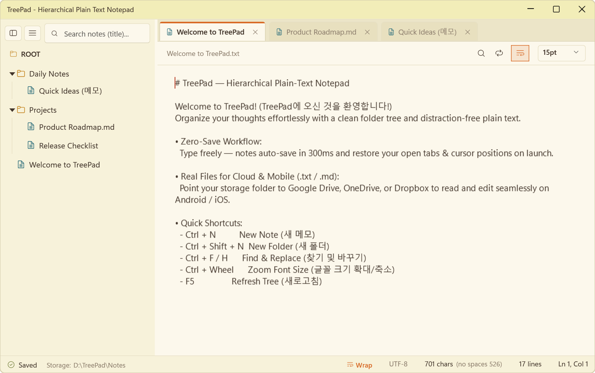

# 🌲 TreePad

> **A minimal, distraction-free hierarchical plain-text notepad for Windows 11.**  
> *Windows 11 전용 미니멀 계층형 순수 텍스트 트리 메모장*

[](https://github.com/yokoncho9/TreePad/releases/latest)
[](https://dotnet.microsoft.com/)
[](https://microsoft.com/windows)
[](LICENSE)
[]()

<p align="center">
  
</p>

---

## 💡 Why TreePad? (Design Philosophy)

Modern note-taking tools often become overly complex, heavyweight document editors with proprietary databases, sluggish startup times, and cluttered toolbars that lock your thoughts away.

**TreePad takes a pure, lightweight approach focused on everyday thought capture:**
- **Lightning-Fast Native Performance**: Launches instantly with zero lag — built specifically as a lightweight Windows 11 desktop app without heavy web runtimes or background bloat.
- **Pure Plain-Text Freedom (Local-First)**: Your notes remain 100% yours as standard UTF-8 `.txt` and `.md` files in real folders. No vendor lock-in, no proprietary single-database corruption risks, and instant sync across clouds and mobile devices.
- **Zero-Save Peace of Mind**: Never worry about pressing save buttons or losing your place. Everything auto-saves silently, and your exact tabs and cursor positions are restored on relaunch.
- **Distraction-Free Comfort**: A warm, paper-like Gruvbox canvas engineered for long hours of writing with maximum eye comfort and minimal visual noise.

---

## 🌟 Highlights

- **🌲 Hierarchical Tree Structure**: Organize your ideas and documents in nested folders and notes with intuitive **drag-and-drop** reordering (including dropping onto `ROOT` to move to top level).
- **⚡ Zero-Save & Lossless Session Restore**: No "Save" dialogs needed. Typing auto-saves in 300ms, switching tabs flushes changes immediately, and your open tabs, window layout, and **per-tab cursor/scroll positions** restore on relaunch.
- **🎨 Eye-Pleasing Gruvbox Paper Theme**: Comfortable warm vanilla cream paper background (`#FCF8EC`) crafted for long hours of distraction-free writing.
- **☁️ Live Cloud & Mobile Sync (`.txt` & `.md`)**: Notes are stored directly as standard folders and UTF-8 `.txt` / `.md` files on disk. Sync effortlessly via **Google Drive**, **OneDrive**, or **Dropbox** to read and edit on Android/iOS with any mobile text app — TreePad watches the folder in real time (`FileSystemWatcher`) and updates automatically!
- **🌐 Complete Bilingual UI**: Seamlessly switch between **English** and **한국어 (Korean)** at runtime. Automatically detects your system language on first launch.
- **🗑️ Safe Delete to Recycle Bin**: Deleted notes and folders move safely to the Windows **Recycle Bin**, preventing accidental permanent loss.
- **🔍 Fast Find & Replace**: Built-in `Ctrl+F` (Find) and `Ctrl+H` (Find & Replace) with instant match navigation.
- **📦 Portable Single-File Executable**: Runs as a self-contained `.exe` with single-instance protection and zero runtime installation required.

---

## 📥 Download & Quick Start

1. Download **`TreePad.exe`** (or **`TreePad-v1.0.2-win-x64.zip`**) from the [**Latest Release**](https://github.com/yokoncho9/TreePad/releases/latest).
2. Run `TreePad.exe` directly — portable and self-contained with no installation required.

> **💡 Note on Windows SmartScreen & Browser Warnings**  
> Because TreePad is an open-source project without a paid commercial EV certificate, Windows or web browsers may show a security notice on first download/launch:
> - **In Browser**: If blocked, choose **Keep / Download anyway**.
> - **In Windows**: If SmartScreen appears, click **More info (`추가 정보`)** → **Run anyway (`실행`)**.
> - If your company firewall blocks direct `.exe` downloads, please download the **`.zip` package** instead.

---

## ⌨️ Keyboard & Mouse Shortcuts

| Shortcut | Description (English) | 설명 (한국어) |
|:---:|:---|:---|
| `Ctrl + N` | Create a new note | 새 메모 만들기 |
| `Ctrl + Shift + N` | Create a new folder | 새 폴더 만들기 |
| `F2` | Rename selected tree item | 선택한 항목 이름 바꾸기 |
| `Delete` | Move selected tree item to Recycle Bin | 선택한 항목 휴지통으로 안전 삭제 |
| `F5` | Refresh folder tree & external changes | 폴더 트리 및 외부 변경 수동 새로고침 |
| `Ctrl + F` | Open Find bar | 텍스트 찾기 |
| `Ctrl + H` | Open Find & Replace bar | 찾아 바꾸기 |
| `F3` / `Shift + F3` | Next / Previous match | 다음 / 이전 일치 단어 |
| `Alt + Z` | Toggle Word Wrap | 자동 줄바꿈 토글 |
| `Ctrl + B` | Collapse / Expand Sidebar | 사이드바 접기 / 펼치기 |
| `Ctrl + W` / `Middle-Click` | Close tab | 탭 닫기 (마우스 휠 클릭 지원) |
| `Ctrl + Wheel` / `Ctrl + +/-/0` | Zoom font size in / out / reset | 글꼴 크기 확대 / 축소 / 초기화 |

---

## 🛠️ Building from Source

### Prerequisites
- [.NET 8 SDK](https://dotnet.microsoft.com/download/dotnet/8.0)
- Windows 10 / 11 (64-bit)

### Build & Publish
```bash
git clone https://github.com/yokoncho9/TreePad.git
cd TreePad

# Build Release
dotnet build src/TreePad/TreePad.csproj -c Release

# Publish self-contained single-file executable
dotnet publish src/TreePad/TreePad.csproj -c Release -r win-x64 --self-contained true -p:PublishSingleFile=true -p:IncludeNativeLibrariesForSelfExtract=true -p:EnableCompressionInSingleFile=true -o publish
```

---

## 🇰🇷 한국어 소개 (Korean Overview)

**TreePad**는 Windows 11 기본 메모장의 군더더기 없는 가벼움에 **폴더/노트 트리 계층 구조**와 **실시간 클라우드 연동성**을 결합한 순수 텍스트 메모장입니다.

### 개발 철학: 왜 TreePad인가?
수많은 최신 노트 앱들이 지나치게 무거운 종합 문서 편집기로 변해가면서, 자체 데이터베이스에 메모를 가두거나 실행 속도가 느려지고 메뉴가 복잡해지는 문제가 있습니다.

TreePad는 **가장 순수하고 빠른 생각 정리**라는 메모장 본연의 가치에 집중했습니다:
- **0초 즉시 실행의 가벼움**: 웹 렌더러 기반의 무거운 앱과 달리, 윈도우 11 네이티브 가속을 통해 더블클릭 즉시 번개처럼 켜집니다.
- **내 컴퓨터의 안전한 파일 소유권**: 특정 앱의 복잡한 단일 DB 파일 하나에 묶이지 않고, 디스크에 실제 폴더와 표준 UTF-8 `.txt`, `.md` 파일로 저장됩니다.
- **스마트폰 및 클라우드 무제한 자유**: 구글 드라이브나 원드라이브를 연결하면 스마트폰의 어떤 메모 앱으로도 언제 어디서나 바로 읽고 쓸 수 있으며, PC에서 실시간으로 자동 동기화됩니다.
- **저장 걱정 없는 무손실 세션**: 타이핑 즉시 자동 저장되고, 창을 닫았다 다시 열어도 보고 있던 탭과 커서 위치가 100% 유지됩니다.

### 핵심 기능 정리
1. **표준 텍스트 기반 (`.txt` & `.md`)**: 전용 데이터베이스에 갇히지 않고 실제 폴더와 UTF-8 `.txt`, `.md` 파일로 저장되므로 구글 드라이브, 원드라이브 및 스마트폰 텍스트 앱에서 자유롭게 함께 열람하고 편집할 수 있습니다.
2. **실시간 외부 변경 감지**: 앱을 켜둔 상태에서 스마트폰이나 클라우드로 동기화된 새 메모/수정 내용도 실시간으로 자동 반영됩니다 (`F5` 수동 새로고침 지원).
3. **무손실 자동 저장 & 탭별 커서 복원**: 저장 버튼 없이 입력 즉시 자동 저장되며, 탭을 옮겨 다니거나 창을 닫았다가 다시 열어도 각 탭의 커서와 스크롤 위치가 그대로 유지됩니다.
4. **편안한 가독성 & 안전한 관리**: 눈이 피로하지 않은 따뜻한 크림 종이 테마, 마우스 드래그 앤 드롭 이동, 윈도우 휴지통 삭제 보호 기능을 기본 제공합니다.

> **💡 처음 실행 시 Windows 보호 창 안내**  
> 별도 설치 과정 없는 개인 오픈소스 단일 실행 파일(`TreePad.exe`) 특성상, 다운로드 후 최초 실행 시 *"Windows의 PC 보호"* 안내창이 나타날 수 있습니다. **`추가 정보`** → **`실행`**을 누르시면 정상 실행됩니다.

---

## 📄 License

This project is licensed under the [MIT License](LICENSE).  
Copyright (c) 2026 [yokoncho9](https://github.com/yokoncho9).
